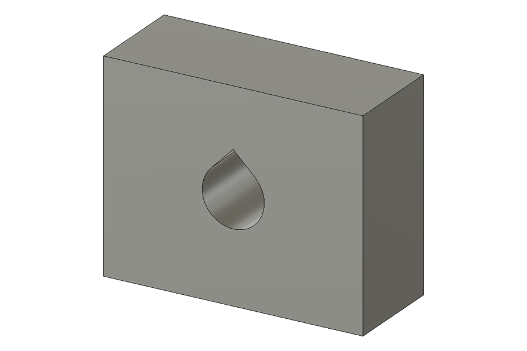
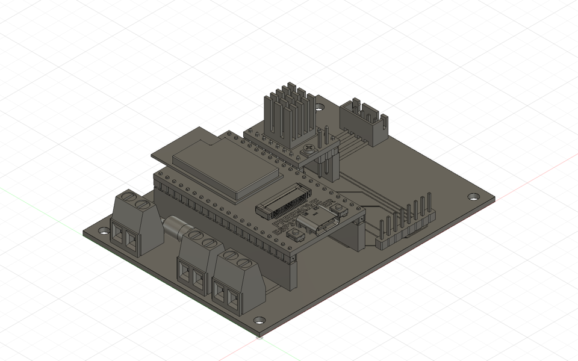

# Fusion 360 skills for Claude Code

Two skills that guide Claude when it drives Fusion 360 through an MCP server: one for designing parts meant for FDM 3D printing, the other for taking a printed circuit board all the way to files that can be ordered from PCBWay.

First version. It will be updated as it gets used, and its content may still change. `fusion-conception-imprimable` is a draft made of rules noted from one project to the next, and it will grow.

Both skills come in English (the default) and in French (the originals, in `fr/`). The English versions are translations: the author uses the French ones, and the English ones have not been run yet. Fusion menu labels are quoted in French, as the skills were written with Fusion set to French.

## Requirements

- Fusion 360.
- An MCP server named `fusion`, which gives Claude the `mcp__fusion__*` tools. The skills use `fusion_mcp_execute` (runs a Python script inside Fusion) and `fusion_mcp_electronics_read` in particular. This server is required and is not included in this repository.
- For `pcb-fusion-pcbway`: Python with Pillow and numpy (`pip install pillow numpy`). Some recipes use PowerShell and desktop control to send Escape to Fusion, on Windows.

## Installation

Copy the folder or folders you want into your skills:

```bash
git clone https://github.com/StashWorkshop/fusion-360-skills.git
cp -r fusion-360-skills/fusion-conception-imprimable ~/.claude/skills/
cp -r fusion-360-skills/pcb-fusion-pcbway ~/.claude/skills/
```

For the French versions, copy the same folders from `fusion-360-skills/fr/` instead. Install only one language of each skill: both share the same skill name.

## fusion-conception-imprimable

The skill triggers as soon as you ask to model, modify or export a part in Fusion 360, and assumes the part will be printed. It has Claude choose the print orientation before drawing, then applies rules that avoid supports: 45° chamfers, teardrop-shaped horizontal holes, short bridges, clearances for parts printed already assembled, pockets for inserts and nuts. Dimensions go into user parameters, and each part is exported as STEP and 3MF in its print orientation.

`references/techniques-fdm.md` is the detailed catalogue. Its values are starting points for a 0.4 mm nozzle, 0.2 mm layers and PLA, to be calibrated on your printer when a fit matters.

Example request: "Draw a wall bracket for this enclosure, held by two M4 screws."



*Example part modelled in Fusion 360 through the MCP server, following the rule for horizontal teardrop holes: the point, at 45° on each side and facing the top of the print, removes the need for support.*

## pcb-fusion-pcbway

The skill follows a board from netlist to order: PCBWay rules loaded before routing, placement, autorouter, ERC and DRC, saving, export, then a check of the exported files. `references/fusion-mcp.md` gives the MCP recipes and the pitfalls of Fusion Electronics, `references/pcbway.md` the manufacturer's capabilities and the design-rule block.

`scripts/check_gerbers.py` reads back the Gerber and drill files that were actually exported. It compares the copper connectivity with the netlist extracted from Fusion, measures the clearance between nets and looks for silkscreen printed over pads:

```bash
python scripts/check_gerbers.py <GerberFiles folder> <.xln file> --pads pads.json --clearance 0.3
```

It exits with 0 if the board can be ordered, 2 if the clearance is below the target, 1 on a blocking defect. The order itself is always placed by the user.

Example request: "Check my board in Fusion and prepare the files for PCBWay."



*Board from one of the author's projects, a resin parts washer, shown in Fusion 360 with its components.*

## Known limits

- Without the `fusion` MCP server, neither skill can act on Fusion.
- `check_gerbers.py` reads the Gerber subset that Fusion produces with the `example_2_layer.cam` template (two layers, files `copper_top.gbr`, `copper_bottom.gbr`, `profile.gbr`…). It locates nets by their drill holes: a pad without a hole, such as a surface-mount pad, is reported as a possible open connection.
- The script cannot see a wrong pinout, only a difference between the files and the Fusion netlist.
- The PCBWay capabilities listed in `references/pcbway.md` are those noted when the skill was written. Check them on the manufacturer's website before ordering.

## License

MIT. See the `LICENSE` file.
